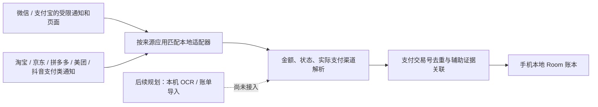

# 多应用、多场景自动记账：公开实现调研与本轮落地

日期：2026-10-27（北京时间）。用户暂停 0.2.7 的手机验证，要求继续开发一个独立的本地账本，覆盖微信、支付宝付款及拼多多等平台购物；不需要同步到其他记账软件。本轮只用虚构数据，不请求用户再次支付或提交真实通知。

## 查阅的原始实现

| 来源及固定版本 | 公开实现依据 | 对本项目的结论 |
|---|---|---|
| [AutoAccounting README](https://github.com/AutoAccountingOrg/AutoAccounting/blob/ed5c2ad94b152f7351d76fcd33f9099a5f7532eb/README.md) | 区分 Hook 内部数据、通知与 OCR，并区分 Xposed、LSPatch、非 Root OCR 模式 | 多场景需要多个数据源。Hook 的覆盖不能当作普通无障碍的覆盖；本轮不引入 Root、修改支付应用、服务器或 AI |
| [AutoAccounting 通知服务](https://github.com/AutoAccountingOrg/AutoAccounting/blob/ed5c2ad94b152f7351d76fcd33f9099a5f7532eb/app/src/main/java/net/ankio/auto/service/NotificationService.kt) / [页面签名](https://github.com/AutoAccountingOrg/AutoAccounting/blob/ed5c2ad94b152f7351d76fcd33f9099a5f7532eb/app/src/main/java/net/ankio/auto/service/ocr/PageSignature.kt) | 通知有包名/关键词过滤，OCR 另有按应用、页面特征选择触发的机制 | 采集入口按应用和来源分开；不无限扩大一个 Activity 白名单，不因相同文本就合并真实付款 |
| [SmartLedger 通知解析](https://github.com/huanghhcri/SmartLedger/blob/66994943701448898401d16e6d423fded6b6dd12/app/src/main/java/com/smartledger/service/NotificationParser.kt) / [监听服务](https://github.com/huanghhcri/SmartLedger/blob/66994943701448898401d16e6d423fded6b6dd12/app/src/main/java/com/smartledger/service/PaymentNotificationListener.kt) | 对不同来源设规则，并处理支付、购物类推送的噪声；源码中也有明确待实机校对的部分 | 采用精确包名的本地适配目录。其他项目写“支持”不是本机验证，不能照搬其模糊包名、聚合通知回扫或推断式合并 |
| [seamless-bookkeeping 通知解析](https://github.com/DykiSensei/seamless-bookkeeping/blob/af717f9faa5658b2e67dcc61e200867951806734/app/src/main/java/com/bookkeeping/app/notification/NotificationParser.kt) | 区分付款/收款，说明部分场景通知不提供完整金额 | 先判断资金方向和实际金额，不把收款当支出；缺信息走待核对，不能靠扩大金额正则补出不存在的信息 |
| [钱迹官方自动记账说明](https://docs.qianjiapp.com/auto/qianji_auto_android.html) | 官方说明其节点识别依赖 Android 与支付应用版本，服务后台限制也会影响运行 | 商业软件同样要持续适配，逆向不能解除系统未提供数据的限制 |
| [钱迹官方外部接口](https://docs.qianjiapp.com/plugin/auto_tasker.html) | URL Scheme 用于接收已经提取好的账单参数 | “采集账单”与“写入记账软件”是两件事。用户本轮不需要外部记账目标，所以不实现此接口，也不把它当作获取付款数据的办法 |

本轮直接阅读公开源码，比先反编译这些已有源码的 APK 更容易核对机制。后续针对具体合法取得的闭源 APK，可以静态分析组件、权限和公开通信方式；不能仅凭反编译代码便声称可读真实支付页面。上述项目的作者声明未在本手机复验。

AutoAccounting 标注 GPL-3.0，另两个项目标注 MIT。本项目只研究机制并独立实现，没有复制第三方代码、引入其依赖/日志/AI/服务器，也没有更改本项目待用户选择的开源许可证。

## 已实现的方向

- `CaptureApp` 表示通知来自哪个应用，`PaymentChannel` 表示实际由微信、支付宝还是未知渠道付款。消费平台和消费分类依旧是独立字段。
- `NotificationAdapters` 内置按应用、来源类型、精确通知标题划分的版本化规则。只用本地声明式数据，不执行外部 JS、不在线拉规则、不读任意应用。包名逐一列出，包含美团主应用及外卖应用；极速版/其他变体未列出便不处理。
- 微信/支付宝保留原入口和隐私边界。五类购物平台新增独立开关，全部默认关闭，升级不自动扩大读取；总开关仍优先。平台本轮仅有通知入口，没有新增购物页面无障碍监听或截图权限。
- 不用“打开过拼多多”推断本次交易属于拼多多，也不把平台名当支付渠道或用途分类。支付渠道仅从明确的付款方式字段识别；未知、多个或冲突时保留未知。
- 平台通知仅辅助核对，单独出现不计支出。同一明确的微信/支付宝支付交易号及相同金额，才能为已有且未被用户编辑的账单补缺失平台，不改变金额、状态、付款时间、商户、分类和用户修改。
- 平台线索先到时留待核对；后来的明确支付主证据可按共同支付交易号关联、核对金额再自动确认，并优先使用支付方的商户信息。同金额不同支付交易号保留两笔。
- 普通平台订单号/通用“交易号”不冒充支付渠道交易号；仅作为事件指纹的一部分。未知支付渠道不建立支付强身份，不按金额、时间或订单号擅自跨来源合并。
- 促销、待付款、发货和客服会话不直接入账。汇总通知、聊天形式通知仍不读取正文；没有可读交易通知时，本轮不能捕获。退款申请/到账、转账、充值、提现仍需核对，不作为消费。

## 支持程度与下一步

上述“已实现”指代码已接入，虚构输入及设备自动化结果见本版交付记录，**不代表这些应用真的会发出当前标题/格式，或用户手机已经成功自动记账**。尤其 0.2.x 的拼多多→微信真实采集没有通过，本轮没有用多来源开关把它改写成成功。

暂停继续围绕同一个微信容器发布诊断修补。接下来独立推进不依赖可见节点文字的本机 OCR，以及微信/支付宝文件导入补漏：先验证离线中文模型的打包、权限、瞬时图像处理与金额/状态规则，再讨论自动触发页面的范围；当前没有实现 OCR、截图或导入，也不要求用户关闭支付安全保护、Root、刷机或安装多个辅助账本。

手机真机测试按用户要求暂停。云端只验证虚构数据、各来源授权边界、混合顺序去重及覆盖升级；需要手机确认时由用户后续恢复测试。
